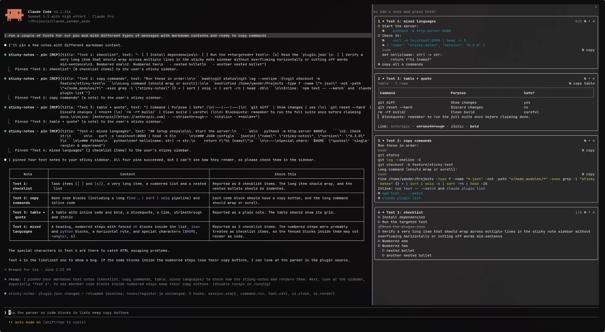

# yander-mods

Claude Code mods by Leander Lorenz Lubguban.

| Mod | What it does |
| :- | :- |
| [sticky-notes](./sticky-notes) | A sticky-note sidebar for pinning Claude's checklists and messages |



## Install

```bash
claude plugin marketplace add y4nder/claude-yander-mods
claude plugin install sticky-notes@yander-mods
```
