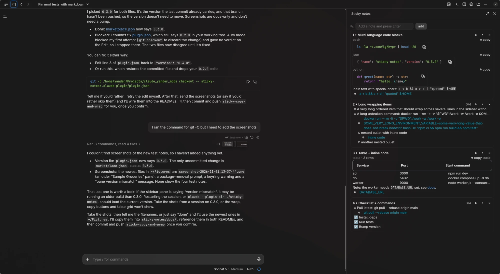
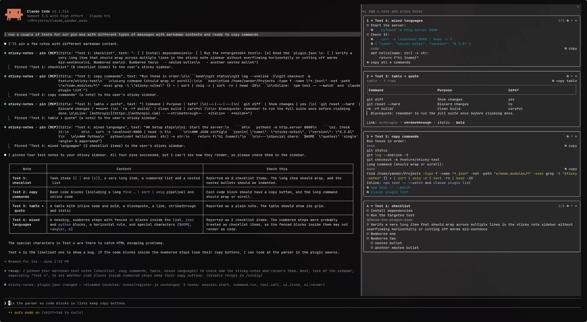

# sticky-notes

A Claude Code mod that adds a sticky-note sidebar on the right. Pin Claude's
checklists and messages so they stay in view while you keep asking questions.

Requires Claude Code v2.1.287 or later. Tested on v2.1.312.





## Install

```bash
claude plugin marketplace add y4nder/claude-yander-mods
claude plugin install sticky-notes@yander-mods
```

To work on it, load the folder directly with `claude --plugin-dir ./sticky-notes`.

## Where it shows

A mod runs on the machine where the session runs, and the sidebar only shows
where that session can draw it.

| Session | Sidebar |
| :- | :- |
| Terminal | Yes |
| Desktop app | Yes, as a "Sticky notes" pane |
| Web, Remote Control or a remote environment | No. Pins still save. |

The sidebar docks on the right in a wide fullscreen terminal (`/tui fullscreen`),
and sits above the prompt in a narrow one.

## Use it

| Command | What it does |
| :- | :- |
| `/pin` | Pin Claude's last message. `/pin 2` pins the one before it. `/pin Deploy steps` sets a title. |
| `/note <text>` | Add your own note |
| `/unpin [n\|all]` | Remove note `n` (1 is the top one), or all of them |
| `/sticky` | Show or hide the sidebar, and focus it |

In the sidebar: **Ctrl+X Tab** focuses it, **Tab/↑↓** move, **Enter** ticks a
checklist item or presses a note's buttons, **Esc** goes back to the prompt,
and **Ctrl+X ←/→** resizes it.

- **Cards**: each note is two lines, `1. Title` and a quiet meta line led by its
  kind (`claude`, `pinned` or `note`, each in its own color), then progress
  (`2/4 done`), how many commands it holds and its age. On the desktop the
  buttons are `⧉` (copy), `✕` (unpin) and `▾`/`▸` (fold). The terminal draws
  them as `copy`, `x` and `-`/`+`.

- **Checklists**: a pinned message with two or more list items becomes tickable
  items: a checkbox on the desktop, `[ ]`/`[x]` in the terminal. Click anywhere
  on the row to tick it. On the desktop, Tab skips the rows: click one, then
  Enter or Space tick it. The terminal ticks with Tab/↑↓ and Enter. Code blocks and indented lines under an item show as its
  detail and hide once the item is ticked. Ticked items fold behind a `▾ N done`
  toggle.
- **Copy**: every note has a copy button that copies it as markdown. `` `Commands` `` and
  fenced code blocks get their own copy button; past three on one note they fold
  into a single "copy all" button. A table cell holding only a `` `code` `` span
  copies on click, and `⧉ copy table` copies the table as markdown. Notes pinned
  before 0.3 keep working but have no per-command buttons until pinned again.
- **Wrapping**: long items and titles wrap inside the pane instead of being cut.
- **Tables**: a semibold header over wrapping cells, set apart by spacing.
- **Claude pins for you**: Claude gets a `pin` tool and is told to use it for
  step-by-step instructions you'll work through. Their meta line starts with
  `claude`.
- **Marker**: a message you pinned with `/pin` shows `📌 pinned to sticky notes`
  under it.
- **Per project**: each project folder has its own board, saved in
  `~/.claude/plugins/store/` so it survives restarts and `/clear`.

## Test

```bash
node --test tests/pins.node-test.js
claude plugin test .
claude plugin validate .
```
